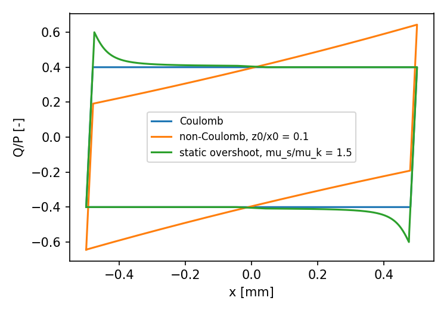

# triboSim

**A physics-based analytical simulator of reciprocating sliding tribological tests.**

`tribosim` generates complete virtual reciprocating sliding tests: the
coefficient of friction (CoF) over the cycles, the friction loop of every
cycle, the wear scar, and the noisy force and displacement signals that a
tribometer would record. Every signal comes with the parameters that produced
it, a ground truth that measured data cannot provide. It is meant for
developing and benchmarking CoF estimation methods, for exploring how test
conditions shape the friction loop, and for generating synthetic data for
data-driven analysis.



## What it models

| Module | Class / function | What it does |
|---|---|---|
| CoF genesis | `FrictionGenesis`, `GenesisEvent` | run-in, piecewise-linear drift, drop and peak events, correlated cycle-to-cycle fluctuation, separately for the forward and backward strokes |
| Kinematics | `Sinusoidal`, `CrankSlider`, `Trapezoidal` | displacement and velocity of the drive, sampled at a fixed frequency |
| Friction loop | `FrictionLoop` | tangential force against displacement, with rig compliance, static-to-kinetic transition (overshoot or rounded run-up), wear scar curvature, and optionally partial slip |
| Wear | `WearModel` | energy-based wear of the flat and of a ball or cylinder counterbody, whose scar reshapes the loop as it grows |
| Acquisition | `add_noise` | correlated instrumental noise set by the sensor range, plus tribological noise |
| Export | `Exporter`, `load_session` | self-describing CSV and saved sessions |

The simulator is quasi-static and of reduced order. See the
[scope and limitations](docs/user_guide.md#8-scope-and-limitations).

## Installation

```bash
git clone https://github.com/illavori/triboSim.git
cd triboSim
pip install -e .                 # requires only NumPy
pip install -e ".[fast,plot]"    # optional: SciPy (faster noise), Matplotlib (examples)
```

## Quick start

```python
from tribosim import FrictionLoop, Sinusoidal

P, x0, f_test = 50.0, 0.5, 5.0                         # N, mm, Hz
x_fw, x_bw, v_fw, v_bw = Sinusoidal().get_stroke(x0, 500, f_test=f_test)

loop = FrictionLoop(contact_force=P, stiffness=2000.0, d_c=0.05,
                    lambda_acc=0.2, lambda_dec=0.2)
x, Q, _ = loop.calculate(z0=0.05, x0=x0,                  # shallow wear groove
                         mu_k_fw=0.4, mu_k_bw=0.4,
                         mu_s_acc_fw=0.6, mu_s_acc_bw=0.6,  # overshoot after reversal
                         mu_s_dec_fw=0.4, mu_s_dec_bw=0.4,
                         x_fw=x_fw, x_bw=x_bw, v_fw=v_fw, v_bw=v_bw)
```

## Documentation

* [User guide](docs/user_guide.md): units, every module and its parameters,
  how to build a complete virtual test.
* [Examples](examples/): one loop, CoF genesis, partial to gross slip, and a
  complete ball-on-flat virtual test exported to CSV.
* [Paper](paper/): the fitted parameters of the article and a script that
  regenerates its simulated curves.

## Tests

```bash
python -m pytest        # or: python tests/test_tribosim.py
```

## Citing

If you use `tribosim`, please cite

> I. Llavori, *An analytical model for virtual reciprocating sliding
> tribological tests* (2026), submitted.

See `CITATION.cff`. The reference will be completed on publication.

## Licence

MIT, see [LICENSE](LICENSE). Contributions and issues are welcome.

Iñigo Llavori, Mondragon Unibertsitatea.
